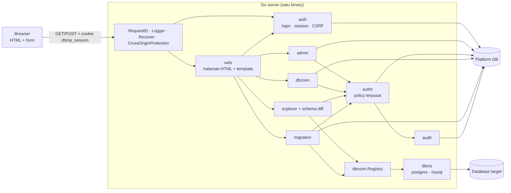

# Arsitektur

Database Management Platform adalah **modular monolith**: satu binary Go yang menyajikan halaman HTML
server-rendered (`html/template`) di `/` dan JSON API di `/api`, dengan satu PostgreSQL sebagai
*platform DB* (user, session, grant, koneksi, riwayat migration, audit). Database yang dikelola user
disebut *database target*. Tidak ada SPA: setiap navigasi memuat halaman penuh dari server dan setiap
aksi adalah form POST yang diakhiri redirect.



## Alur request halaman terlindungi

1. Middleware umum (`httpx.NewRouter`): request ID, logger yang tidak mencatat query/body/cookie,
   recover panic dan `http.CrossOriginProtection`.
2. `web.Server.protect`: memanggil `auth.Service.WebAuthenticate` (cookie, validasi session, rotasi), lalu
   menaruh `authz.Principal` di context. Tanpa session valid, request GET diarahkan (303) ke
   `/login?next=...`. Untuk method non-GET, field form `_csrf` dibandingkan constant-time dengan token
   HMAC milik family session.
3. Handler halaman (`internal/web/*_pages.go`): membaca query dan form, memanggil service domain.
4. Service domain: memanggil `authz.Authorizer.Authorize(principal, aksi, database)` lalu menjalankan
   logika bisnis. Penolakan otomatis tercatat di audit log.
5. Hasil dirender dengan `Render` (template), atau `Redirect` (303 + flash) setelah mutasi. Error dipetakan
   `Fail` menjadi halaman error (403, 404, 409, 422, 503, 500). JSON API di `/api/*` memakai
   `auth.Middleware` dan Problem Details seperti sebelumnya.

## Layering

```
handler (halaman HTML / JSON)  →  service (logika + authz)  →  sqlc queries / dbms driver
```

- Handler tidak berisi SQL; service tidak tahu soal HTTP.
- Domain tidak memanggil query domain lain secara langsung; lewat service atau interface.
- Query platform DB ditulis sebagai SQL biasa di `platformdb/queries/*.sql` (satu file per domain) dan
  di-generate oleh sqlc. Schema platform DB dikelola goose (`platformdb/migrations`, di-embed dan
  dijalankan otomatis saat server start). Ini terpisah dari fitur migration milik user.

## Paket

| Paket | Isi | Pemilik |
|---|---|---|
| `cmd/server` | entrypoint, wiring semua domain | Miguel |
| `cmd/dbmpctl` | CLI `create-admin` | Miguel |
| `internal/config` | env var → struct | Miguel |
| `internal/httpx`, `internal/apperr` | router, middleware umum, Problem Details, pagination | Miguel |
| `internal/auth` | password Argon2id, session, CSRF, handler login/logout/me | Miguel |
| `internal/authz` | daftar aksi, policy, level efektif multi-group | Miguel |
| `internal/admin` | API user, group, anggota, grant | Miguel |
| `internal/audit` | audit log + pencatat penolakan authz | Miguel |
| `internal/web` | lapisan halaman: server, render, flash, CSRF form, template, CSS; halaman login, admin, koneksi, explorer, schema diff | Miguel, Edo |
| `internal/secret` | AES-256-GCM untuk password database target | Edo |
| `internal/dbms` | interface driver + implementasi PostgreSQL dan MySQL | Edo, Rhino |
| `internal/dbconn` | CRUD koneksi, test koneksi, registry pool per database | Edo |
| `internal/schema`, `internal/explorer`, `internal/schemadiff` | introspeksi, viewer, snapshot, diff | Edo |
| `internal/migration` | draft, eksekusi transaksional, riwayat, EXPLAIN | Rhino |
| `internal/sqlsplit` | pemecah dan validator statement SQL; dipakai `migration` dan driver `dbms` | Rhino |
| `internal/web` (halaman migration) | `migration_pages.go` dan `templates/migrations` | Rhino |

## Lapisan web

- `web.Server` menyediakan `Render`, `Redirect` (303 + flash cookie sekali-baca), `Fail` (pemetaan error
  ke halaman), `AddNav` dan `AddDatabaseTab` agar setiap domain mendaftarkan menunya sendiri.
- Template `html/template` di `internal/web/templates` (satu `layout.html`, partial bersama, satu
  direktori per domain). Escaping otomatis; tidak ada `template.HTML` pada data pengguna.
- Semua mutasi memakai `POST` dengan pola Post/Redirect/Get; validasi gagal menampilkan form yang sama
  dengan status 422. Aksi destruktif memakai halaman konfirmasi.
- Header keamanan pada setiap halaman: `Content-Security-Policy: default-src 'self'`, `nosniff`,
  `Cache-Control: no-store`. Tidak ada JavaScript.
- Menyembunyikan tombol di template hanya kenyamanan; service tetap memeriksa hak akses.

### Menambah halaman baru

Contoh (di dalam paket `internal/web`, mengikuti `connections_pages.go`):

```go
func (s *Server) mountReports(r chi.Router) {
	r.Get("/reports", s.reportList)
	r.Post("/reports/new", s.reportCreate)
}

func (s *Server) reportList(w http.ResponseWriter, r *http.Request) {
	p, err := s.authorizeAction(r, authz.ActionManageGroups)
	if err != nil {
		s.Fail(w, r, err)
		return
	}
	items, err := s.reports.List(r.Context(), p)
	if err != nil {
		s.Fail(w, r, err)
		return
	}
	s.Render(w, r, http.StatusOK, "reports/list", reportsView{Items: items})
}
```

Template `templates/reports/list.html` mendefinisikan `title` dan `content`; form selalu menyertakan
`{{template "csrf" .}}`:

```html
{{define "title"}}Laporan{{end}}
{{define "content"}}
<form method="post" action="/reports/new">{{template "csrf" .}}<button class="btn" type="submit">Buat</button></form>
{{end}}
```

Tes memakai fixture `newEnv` (`pages_setup_test.go`) dan `fakeGuard`; tes `route_contract_test.go`
otomatis memeriksa rute baru (wajib login, wajib `_csrf` pada POST, menolak request lintas situs):

```go
func TestReportListRejectsNonAdmin(t *testing.T) {
	e := newEnv(t, false)
	assert.Equal(t, http.StatusForbidden, e.get("/reports", viewerID).Code)
}
```

Daftarkan menu dengan `AddNav(NavItem{Label: "Laporan", Path: "/reports", AdminOnly: true})`, panggil
`mountReports` di dalam `Mount`, dan setiap mutasi harus `POST` yang diakhiri `Redirect` (303).

## Build dan deploy

- **Dev:** `make dev` (container DB) + `make run` (server :8080). Dengan `APP_ENV=dev` template dibaca dari
  disk sehingga perubahan terlihat tanpa menjalankan ulang server.
- **Demo/production:** `make build` membuat `bin/dbmp` dengan template dan aset statis ter-embed
  (`embed.FS`); satu port, satu origin. Set `APP_ENV=production` di belakang HTTPS agar cookie memakai
  `Secure`.

## Testing

- Unit test untuk logika murni (policy, password, splitter SQL, diff, error mapping).
- Integration test memanggil handler/service dengan PostgreSQL/MySQL sungguhan lewat testcontainers;
  waktu session dikendalikan lewat clock yang di-inject sehingga idle, absolute, rotasi, dan grace bisa
  diuji tanpa menunggu.
- Halaman: `httptest` terhadap router penuh (status, redirect, cookie, isi HTML, penolakan akses, CSRF) dengan
  fixture testcontainers; alur login → admin → explorer → logout diuji dengan session asli di `cmd/server`.

## Kontrak antar ruas (Milestone 2)

Tiga ruas pekerjaan (migration, queue dan worker, eksekusi di target) hanya bertemu di interface
berikut. Setiap interface punya fake untuk test.

### `dbms.Migrator` dan `dbms.BatchMigrator`: eksekusi di database target

Dipanggil worker, diimplementasi driver PostgreSQL. Fake untuk keduanya: `dbms.FakeMigrator`.

- `Migrator.Apply` menjalankan SQL dalam satu transaction dan mencatat `RunID` di tabel
  `_dbmp_schema_history` pada database target. `Direction` membedakan SQL up (apply, forward) dari SQL
  down (rollback).
- `Migrator.CommittedVersion` memeriksa apakah sebuah `RunID` benar-benar ter-commit di target. Ini bukti
  eksekusi yang diperiksa sebelum retry ketika hasil commit belum pasti.
- `BatchMigrator` menjalankan migration per batch: `ApplyBatches`, `RevertBatches`, dan `BatchProgress`.
  - SQL batch harus satu statement yang memakai `$1` (cursor, eksklusif) dan `$2` (batas, inklusif),
    misalnya `UPDATE t SET ... WHERE id > $1 AND id <= $2`. Kolom batch harus integer dan unik.
  - Checkpoint disimpan di database target per `RunID`. Memanggil `ApplyBatches` lagi dengan `RunID`
    yang sama melanjutkan dari checkpoint.
  - `RevertBatches` menerima `RunID` eksekusi yang dibatalkan dan `ByRunID` eksekusi rollback-nya.
  - `BatchProgress.State()` menghasilkan `partial`, `completed`, `partially_reverted`, atau `reverted`.
  - `OnBatch` dipanggil setelah setiap batch ter-commit, untuk memperbarui progres job dan memperpanjang
    lock database.

Rincian mode batch dan hasil ujinya ada di README.

### `queue.Publisher`: memasukkan eksekusi ke antrean

Dipanggil service migration saat pengguna menekan eksekusi pada request yang sudah Approved, diimplementasi
paket `queue`. Fake: `queue.Fake`.

- `Publish` membuat job untuk satu request (apply, rollback, atau forward) dan langsung mengembalikan job
  ID tanpa menunggu SQL selesai. `ActorID` adalah pengguna yang menekan eksekusi.
- Idempotent per request: satu request hanya punya satu job (`jobs.request_id` unik). `Publish` kedua
  untuk request yang sama mengembalikan job ID yang sama, sehingga pesan duplikat tidak menghasilkan
  eksekusi ganda. Jika job itu berstatus gagal atau partial, `Publish` mengantrekannya kembali untuk
  dilanjutkan dari checkpoint.
- Trace context diambil dari `ctx` dan disimpan di job, lalu dilanjutkan oleh worker.

### `queue.Lifecycle`: siklus satu eksekusi

Dipanggil worker, diimplementasi service migration. Fake: `queue.FakeLifecycle`. Interface ini berada di
paket `queue` (pihak pemanggil) karena `migration` sudah mengimpor `queue` untuk `Publisher`.

- `Start` dipanggil sekali per attempt, setelah worker memegang lock database. Service migration
  melakukan revalidasi (approval masih lengkap, urutan linear masih sah, revisi SQL tidak berubah), lalu
  mencatat attempt sebagai baris baru di riwayat beserta salinan SQL yang dijalankan, dan mengembalikan
  `Execution` berisi apa yang harus dijalankan.
  - `Direction` adalah `up` untuk apply dan forward, `down` untuk rollback.
  - `Batch` berisi `nil` untuk mode biasa.
  - `RunID` adalah ID attempt ini. `CheckpointRunID` adalah ID run pemilik checkpoint batch di database
    target: sama dengan `RunID` pada attempt pertama, tetap sama saat retry agar eksekusi lanjut dari
    checkpoint, dan pada rollback menunjuk run yang dibatalkan.
  - Error bertipe `*apperr.Error` berarti revalidasi menolak dan job tidak di-retry. Error lain dianggap
    sementara.
- `Finish` dipanggil sekali per attempt setelah hasilnya pasti. `Err` kosong berarti berhasil. Jika `Err`
  terisi dan `Progress` menunjukkan sebagian batch sudah ter-commit, hasilnya partial; selain itu gagal.
  `WillRetry` memberi tahu bahwa attempt berikutnya masih akan dijalankan, sehingga request belum boleh
  ditandai gagal.
- Jika hasil commit belum pasti (`dbms.ErrCommitUncertain`), worker memeriksa `CommittedVersion` lebih
  dulu dan baru memanggil `Finish` setelah hasilnya diketahui.
