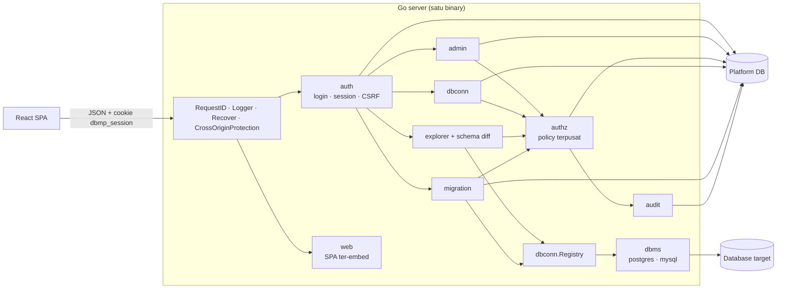

# Arsitektur

Database Management Platform adalah **modular monolith**: satu binary Go yang menyajikan JSON API di
`/api` dan SPA React di `/`, dengan satu PostgreSQL sebagai *platform DB* (user, session, grant, koneksi,
riwayat migration, audit). Database yang dikelola user disebut *database target*.



## Alur request terlindungi

1. Middleware umum (`httpx.NewRouter`): request ID, logger yang tidak mencatat query/body/cookie,
   recover panic → 500 Problem Details, dan `http.CrossOriginProtection`.
2. `auth.Middleware`: membaca cookie, memvalidasi session (revoke, idle, absolute, grace), merotasi bila
   perlu, memeriksa `X-CSRF-Token` untuk method non-GET, lalu menaruh `authz.Principal` di context.
3. Handler domain: parsing input, memanggil service.
4. Service domain: memanggil `authz.Authorizer.Authorize(principal, aksi, database)` lalu menjalankan
   logika bisnis. Penolakan otomatis tercatat di audit log.
5. Error dikembalikan sebagai `apperr.Error` dan dipetakan sekali di `httpx.Error` menjadi status HTTP +
   Problem Details.

## Layering

```
handler (HTTP)  →  service (logika + authz)  →  sqlc queries / dbms driver
```

- Handler tidak berisi SQL; service tidak tahu soal HTTP.
- Domain tidak memanggil query domain lain secara langsung; lewat service atau interface.
- Query platform DB ditulis sebagai SQL biasa di `platformdb/queries/*.sql` (satu file per domain) dan
  di-generate oleh sqlc. Schema platform DB dikelola goose (`platformdb/migrations`, di-embed dan
  dijalankan otomatis saat server start). Ini terpisah dari fitur migration milik user.

## Paket

| Paket | Isi | Pemilik |
|---|---|---|
| `cmd/server` | entrypoint, wiring semua domain | Miguel |
| `cmd/dbmpctl` | CLI `create-admin` | Miguel |
| `internal/config` | env var → struct | Miguel |
| `internal/httpx`, `internal/apperr` | router, middleware umum, Problem Details, pagination | Miguel |
| `internal/auth` | password Argon2id, session, CSRF, handler login/logout/me | Miguel |
| `internal/authz` | daftar aksi, policy, level efektif multi-group | Miguel |
| `internal/admin` | API user, group, anggota, grant | Miguel |
| `internal/audit` | audit log + pencatat penolakan authz | Miguel |
| `internal/web` | penyaji SPA ter-embed dengan fallback ke `index.html` | Miguel |
| `internal/secret` | AES-256-GCM untuk password database target | Edo |
| `internal/dbms` | interface driver + implementasi PostgreSQL dan MySQL | Edo, Rhino |
| `internal/dbconn` | CRUD koneksi, test koneksi, registry pool per database | Edo |
| `internal/schema`, `internal/explorer`, `internal/schemadiff` | introspeksi, viewer, snapshot, diff | Edo |
| `internal/migration` | draft, eksekusi transaksional, riwayat, EXPLAIN | Rhino |
| `frontend/src/app`, `features/auth`, `features/admin`, `lib/api` | shell, login, halaman admin, interceptor CSRF/401 | Miguel |
| `frontend/src/features/{connections,explorer,schema-diff}` | halaman koneksi dan explorer | Edo |
| `frontend/src/migrations` | halaman migration | Rhino |

## Frontend

- React Router dengan `ProtectedRoute` (wajib login) dan `AdminRoute` (wajib Platform Admin, hanya untuk
  UX; backend tetap memeriksa).
- TanStack Query untuk server state; tipe request/response di-generate dari OpenAPI (`openapi-typescript`).
- Interceptor `fetch` (`lib/api/session.ts`) menambahkan `X-CSRF-Token` ke semua request yang mengubah
  state ke origin sendiri, dan mengarahkan ke halaman login saat API membalas 401.

## Build dan deploy

- **Dev:** `make dev` (container DB) + `make run` (backend :8080) + `npm run dev` di `frontend/`
  (Vite :5173, mem-proxy `/api` ke :8080). Browser hanya melihat satu origin.
- **Demo/production:** `make build` mem-build SPA, menyalinnya ke `backend/internal/web/dist`, lalu
  membuat `bin/dbmp` yang menyajikan SPA dan API dari satu port. Set `APP_ENV=production` di belakang
  HTTPS agar cookie memakai `Secure`.

## Testing

- Unit test untuk logika murni (policy, password, splitter SQL, diff, error mapping).
- Integration test memanggil handler/service dengan PostgreSQL/MySQL sungguhan lewat testcontainers;
  waktu session dikendalikan lewat clock yang di-inject sehingga idle, absolute, rotasi, dan grace bisa
  diuji tanpa menunggu.
- Frontend: Vitest + Testing Library + MSW.
