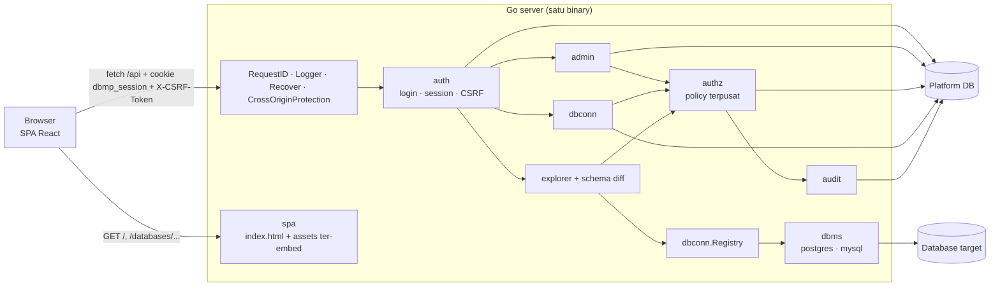

# Arsitektur

Database Management Platform adalah **modular monolith**: satu binary Go yang menyajikan SPA React di `/`
dan JSON API di `/api`, dengan satu PostgreSQL sebagai *platform DB* (user, session, grant, koneksi,
definisi dan riwayat migration, audit). Database yang dikelola user disebut *database target*. SPA
di-build oleh Vite lalu di-embed ke binary, sehingga browser hanya berbicara dengan satu origin.



## Alur request terlindungi

1. Middleware umum (`httpx.NewRouter`): request ID, logger yang tidak mencatat query/body/cookie,
   recover panic dan `http.CrossOriginProtection`.
2. `auth.Service.Middleware` (semua route `/api` kecuali `/api/auth/login` dan `/api/healthz`): membaca
   cookie `dbmp_session`, memvalidasi dan merotasi session, lalu menaruh `authz.Principal` di context.
   Tanpa session valid, respons 401. Untuk method non-GET, header `X-CSRF-Token` dibandingkan
   constant-time dengan token HMAC milik family session.
3. Handler domain (`handler.go` di tiap paket): decode JSON, memanggil service, menulis JSON atau
   Problem Details (`application/problem+json`) lewat `httpx`.
4. Service domain: memanggil `authz.Authorizer.Authorize(principal, aksi, database)` lalu menjalankan
   logika bisnis. Penolakan otomatis tercatat di audit log.

Di sisi browser, `installFetchInterceptor` (`frontend/src/lib/api/session.ts`) menambahkan
`X-CSRF-Token` pada setiap request non-GET ke origin sendiri dan mengarahkan ke halaman login saat API
membalas 401. Token CSRF didapat dari respons `POST /api/auth/login` dan `GET /api/auth/me`.

## Layering

```
SPA (React + react-query)  →  handler (JSON)  →  service (logika + authz)  →  sqlc queries / dbms driver
```

- Handler tidak berisi SQL; service tidak tahu soal HTTP.
- Domain tidak memanggil query domain lain secara langsung; lewat service atau interface.
- Query platform DB ditulis sebagai SQL biasa di `platformdb/queries/*.sql` (satu file per domain) dan
  di-generate oleh sqlc. Schema platform DB dikelola goose (`platformdb/migrations`, di-embed dan
  dijalankan otomatis saat server start). Ini terpisah dari fitur migration milik user.
- Kontrak API ada di `api/openapi.yaml`. Tipe Go (`internal/apigen`) dan tipe TypeScript
  (`frontend/src/lib/api/schema.d.ts`) di-generate dari file itu oleh `make gen`.

## Paket

| Paket | Isi | Pemilik |
|---|---|---|
| `cmd/server` | entrypoint, wiring semua domain | Miguel |
| `cmd/dbmpctl` | CLI `create-admin` dan `seed-demo` | Miguel |
| `internal/config` | env var → struct | Miguel |
| `internal/httpx`, `internal/apperr` | router, middleware umum, Problem Details, pagination | Miguel |
| `internal/apigen` | tipe hasil generate dari OpenAPI | (generate) |
| `internal/auth` | password Argon2id, session, CSRF, handler login/logout/me | Miguel |
| `internal/authz` | daftar aksi, policy, level efektif multi-group | Miguel |
| `internal/admin` | API user, group, anggota, grant | Miguel |
| `internal/audit` | audit log + pencatat penolakan authz | Miguel |
| `internal/queue` | kontrak `Publisher` dan `Lifecycle` (Milestone 2) | Miguel |
| `internal/spa` | menyajikan SPA ter-embed, fallback `index.html` untuk deep link | Edo |
| `internal/secret` | AES-256-GCM untuk password database target | Edo |
| `internal/sqltrace` | log dan span untuk setiap query ke platform DB dan database target | Edo |
| `internal/dbms` | interface driver, eksekusi up/down dan per batch, implementasi PostgreSQL dan MySQL | Edo, Rhino |
| `internal/dbconn` | CRUD koneksi, test koneksi, registry pool per database | Edo |
| `internal/schema`, `internal/explorer`, `internal/schemadiff` | introspeksi, viewer, snapshot, diff | Edo |
| `internal/migration` | draft, eksekusi transaksional, riwayat, reconciler | Rhino |
| `internal/sqlsplit` | pemecah dan validator statement SQL; dipakai `migration` dan driver `dbms` | Rhino |

## Frontend

- `frontend/src/app`: router, layout, dan shell. Route dikelompokkan per fitur (`features/*/routes.tsx`)
  di bawah `ProtectedRoute` (wajib login) dan `AdminRoute` (Platform Admin).
- `frontend/src/features/<fitur>`: satu folder per fitur (halaman, hook react-query di `api.ts`, test).
  Yang disentuh bersama hanya daftar route di `app/router.tsx`.
- `frontend/src/components`: komponen bersama (`ui/button`, `ui/form`, `ErrorState`).
- Menyembunyikan tombol di SPA hanya kenyamanan; service tetap memeriksa hak akses.
- Responsif: navigasi, form, dan dialog tetap terjangkau di layar mobile; tabel lebar dan editor SQL
  di-scroll di dalam komponennya.

## Build dan deploy

- **Dev:** `make dev` (container DB), `make run` (API :8080), dan `make web-dev` (Vite :5173 dengan hot
  reload, `/api` diteruskan ke :8080).
- **Demo/production:** `make build` mem-build SPA, menyalinnya ke `backend/internal/spa/dist`, lalu
  membuat `bin/dbmp` dengan SPA ter-embed (`embed.FS`); satu port, satu origin. Aset di `assets/`
  di-cache permanen, `index.html` memakai `Cache-Control: no-cache`. Set `APP_ENV=production` di belakang
  HTTPS agar cookie memakai `Secure`.

## Testing

- Unit test untuk logika murni (policy, password, splitter SQL, diff, error mapping).
- Integration test memanggil handler/service dengan PostgreSQL/MySQL sungguhan lewat testcontainers;
  waktu session dikendalikan lewat clock yang di-inject sehingga idle, absolute, rotasi, dan grace bisa
  diuji tanpa menunggu.
- `cmd/server`: `httptest` terhadap router penuh, yaitu wiring route, penolakan akses, CSRF, fallback SPA,
  dan jaminan bahwa log tidak pernah memuat password, cookie session, token CSRF, maupun query string.
- Frontend: Vitest + Testing Library dengan MSW sebagai pengganti API.

## Logging dan tracing

Paket `internal/telemetry` memasang OpenTelemetry saat proses mulai (`telemetry.Setup`):

- Propagator W3C (`traceparent`) dan TracerProvider dengan `service.name`.
- Exporter diatur `OTEL_TRACES_EXPORTER`: `console` (default) menulis setiap span sebagai satu baris JSON
  ke **stderr**, `none` mematikannya. Log tetap di **stdout**, jadi keduanya bisa dipisah.
- Span ditulis lewat batcher dan dikirim saat proses berhenti, jadi proses yang mati mendadak bisa
  kehilangan span terakhir. Log tidak terpengaruh.

### Rantai trace

Satu eksekusi migration berada di satu trace, walaupun API dan worker berjalan di proses berbeda:

```
POST /api/databases/{databaseId}/...        span server (httpx.Trace)
├── sql.query ...                           query platform DB selama request (sqltrace)
└── (jobs.trace_context: traceparent)       disimpan Publish, dibaca Claim
    └── queue.job                           worker, induknya remote
        ├── queue.lock                      pengambilan lock database
        ├── sql.query ...                   revalidasi dan riwayat di platform DB
        └── sql.query CREATE TABLE ...      SQL migration di database target
```

- Span HTTP dibuat untuk setiap request `/api` kecuali `/api/healthz`. Namanya memakai pola route chi,
  bukan path asli, supaya ID tidak membuat nama span tak terbatas. Status 5xx menandai span error.
- `trace_context` di job hanya berisi `traceparent`. Baggage dari client tidak ikut tersimpan.
- Pemulihan membuat span `queue.recover` di trace asal job tersebut.
- `TestOneTraceSpansFromAPIRequestToSQLInWorker` (paket `queue`) menguji rantai ini.
- `cmd/worker` belum ada. Saat dibuat, binary itu harus memanggil `telemetry.Setup` dengan `service.name`
  `dbmp-worker`, memakai `telemetry.NewHandler` untuk log, dan memasang `sqltrace.Tracer` di pool platform
  DB maupun koneksi target, supaya span SQL di worker ikut tercatat.

### Atribut log

`telemetry.Handler` menambahkan atribut berikut ke setiap log yang ditulis dengan context, tanpa menimpa
atribut yang sudah ditulis pemanggil:

| Atribut | Sumber |
|---|---|
| `trace_id`, `span_id` | span aktif |
| `request_id` | ID request HTTP (middleware chi) |
| `actor` | user yang login, atau pembuat job di worker |
| `job_id`, `migration_request_id`, `database_id`, `attempt` | worker, lewat `sqltrace.With` |
| `run_id`, `migration_id` | worker, setelah `Lifecycle.Start` |

Log memakai `event` dan `status` yang baku: `http`, `job.start`, `lock.acquire`, `job.retry`,
`job.uncertain`, `job.abandon`, `job.recover`, `job.end`, dan `sql.query.start`/`sql.query.end` (juga
`sql.begin`, `sql.commit`, `sql.rollback`).

Contoh satu job (diringkas, satu baris per log):

```json
{"level":"INFO","msg":"http","method":"POST","path":"/api/databases/1/migrations/7/apply","route":"/api/databases/{databaseId}/migrations/{migrationId}/apply","status":202,"duration_ms":0,"request_id":"host/ygqdvzoFXP-000001","trace_id":"4468d7c57b9351619a40ad8bf4cc1914","span_id":"fcb930beb9612f62"}
{"level":"INFO","msg":"job.start","event":"job.start","status":"running","trace_id":"4468d7c57b9351619a40ad8bf4cc1914","span_id":"e03429965e794401","job_id":10,"migration_request_id":20,"database_id":1,"actor":3,"attempt":1}
{"level":"INFO","msg":"lock.acquire","event":"lock.acquire","status":"acquired","trace_id":"4468d7c57b9351619a40ad8bf4cc1914","span_id":"48a4d1bf9e47f7a7","job_id":10,"migration_request_id":20,"database_id":1,"actor":3,"attempt":1}
{"level":"INFO","msg":"sql.query.end","event":"sql.query","target":"target","database":"inventory","server":"target-db:5432","job_id":10,"migration_request_id":20,"database_id":1,"actor":3,"attempt":1,"run_id":1,"migration_id":7,"query":"CREATE TABLE t ()","duration_ms":0.8,"rows":0,"status":"ok","trace_id":"4468d7c57b9351619a40ad8bf4cc1914","span_id":"ca4004a1c8cf50d1"}
{"level":"INFO","msg":"job.end","event":"job.end","status":"succeeded","duration_ms":3,"trace_id":"4468d7c57b9351619a40ad8bf4cc1914","span_id":"e03429965e794401","job_id":10,"migration_request_id":20,"database_id":1,"actor":3,"attempt":1,"run_id":1,"migration_id":7}
```

Semua log satu eksekusi bisa dicari dengan `trace_id`-nya, misalnya
`docker compose logs app | grep 4468d7c57b9351619a40ad8bf4cc1914`.

Contoh span `queue.job` dari exporter console (diringkas):

```json
{"Name":"queue.job","SpanContext":{"TraceID":"4468d7c57b9351619a40ad8bf4cc1914","SpanID":"e03429965e794401"},"Parent":{"TraceID":"4468d7c57b9351619a40ad8bf4cc1914","SpanID":"fcb930beb9612f62","Remote":true},"SpanKind":1,"Attributes":[{"Key":"job.id","Value":{"Type":"INT64","Value":10}},{"Key":"job.migration_request_id","Value":{"Type":"INT64","Value":20}},{"Key":"job.database_id","Value":{"Type":"INT64","Value":1}},{"Key":"job.attempt","Value":{"Type":"INT64","Value":1}}],"Status":{"Code":"Unset"},"Resource":[{"Key":"service.name","Value":{"Type":"STRING","Value":"dbmp-server"}}]}
```

`Parent.SpanID` sama dengan `span_id` log `http` di atas, dan `Remote: true` menandakan induknya datang
dari proses lain lewat tabel `jobs`.

### Data sensitif

- Span HTTP hanya mencatat method, path tanpa query string, route, status, dan request ID. Header,
  cookie, dan body tidak pernah dicatat.
- SQL di log dan span disamarkan `sqltrace.Mask` (`PASSWORD '***'`). Nilai parameter tidak dicatat,
  kecuali `sqltrace.Tracer.LogArgs` dinyalakan (tidak dipakai di server).
- `TestLogsAndSpansNeverContainSecrets` (`cmd/server`) menjalankan alur login, CSRF, koneksi database,
  user, dan explorer dengan log dan exporter yang sama seperti production, lalu memastikan password,
  cookie session, token CSRF, dan query string tidak muncul di log maupun span.
  `TestTraceAndRequestLogNeverRecordCredentials` (`httpx`) memeriksa hal yang sama tanpa Docker.

## Kontrak antar ruas (Milestone 2)

Tiga ruas pekerjaan (migration, queue dan worker, eksekusi di target) hanya bertemu di interface
berikut. Setiap interface punya fake untuk test.

### `dbms.Migrator` dan `dbms.BatchMigrator`: eksekusi di database target

Dipanggil worker, diimplementasi driver PostgreSQL. Fake untuk keduanya: `dbms.FakeMigrator`.

- `Migrator.Apply` menjalankan SQL dalam satu transaction dan mencatat `RunID` di tabel
  `_dbmp_schema_history` pada database target. `Direction` membedakan SQL up (apply, forward) dari SQL
  down (rollback).
- `Migrator.CommittedVersion` memeriksa apakah sebuah `RunID` benar-benar ter-commit di target. Ini bukti
  eksekusi yang diperiksa sebelum retry ketika hasil commit belum pasti.
- `BatchMigrator` menjalankan migration per batch: `ApplyBatches`, `RevertBatches`, dan `BatchProgress`.
  - SQL batch harus satu statement yang memakai `$1` (cursor, eksklusif) dan `$2` (batas, inklusif),
    misalnya `UPDATE t SET ... WHERE id > $1 AND id <= $2`. Kolom batch harus integer dan unik.
  - Checkpoint disimpan di database target per `RunID`. Memanggil `ApplyBatches` lagi dengan `RunID`
    yang sama melanjutkan dari checkpoint.
  - `RevertBatches` menerima `RunID` eksekusi yang dibatalkan dan `ByRunID` eksekusi rollback-nya.
  - `BatchProgress.State()` menghasilkan `partial`, `completed`, `partially_reverted`, atau `reverted`.
  - `OnBatch` dipanggil setelah setiap batch ter-commit; worker memakainya untuk memperbarui progres job.

Rincian mode batch dan hasil ujinya ada di README.

### `queue.Publisher`: memasukkan eksekusi ke antrean

Dipanggil service migration saat pengguna menekan eksekusi pada request yang sudah Approved, diimplementasi
paket `queue`. Fake: `queue.Fake`.

- `Publish` membuat job untuk satu request (apply, rollback, atau forward) dan langsung mengembalikan job
  ID tanpa menunggu SQL selesai. `ActorID` adalah pengguna yang menekan eksekusi.
- Idempotent per request: satu request hanya punya satu job (`jobs.request_id` unik). `Publish` kedua
  untuk request yang sama mengembalikan job ID yang sama, sehingga pesan duplikat tidak menghasilkan
  eksekusi ganda. Jika job itu berstatus gagal atau partial, `Publish` mengantrekannya kembali untuk
  dilanjutkan dari checkpoint.
- Trace context diambil dari `ctx` dan disimpan di job, lalu dilanjutkan oleh worker.
- Implementasi: `queue.NewPostgres(db)`. `Publish` hanya menulis tabel `jobs`; status request tetap
  diubah service migration. `db` boleh berupa `pgx.Tx`, sehingga perubahan status request menjadi
  `queued` dan pembuatan job bisa di-commit dalam satu transaction.

### `queue.Lifecycle`: siklus satu eksekusi

Dipanggil worker, diimplementasi service migration. Fake: `queue.FakeLifecycle`. Interface ini berada di
paket `queue` (pihak pemanggil) karena `migration` sudah mengimpor `queue` untuk `Publisher`.

- `Start` dipanggil sekali per attempt, setelah worker memegang lock database. Service migration
  melakukan revalidasi (approval masih lengkap, urutan linear masih sah, revisi SQL tidak berubah), lalu
  mencatat attempt sebagai baris baru di riwayat beserta salinan SQL yang dijalankan, dan mengembalikan
  `Execution` berisi apa yang harus dijalankan.
  - `Direction` adalah `up` untuk apply dan forward, `down` untuk rollback.
  - `Batch` berisi `nil` untuk mode biasa.
  - `RunID` adalah ID attempt ini. `CheckpointRunID` adalah ID run pemilik checkpoint batch di database
    target: sama dengan `RunID` pada attempt pertama, tetap sama saat retry agar eksekusi lanjut dari
    checkpoint, dan pada rollback menunjuk run yang dibatalkan.
  - Error bertipe `*apperr.Error` berarti revalidasi menolak dan job tidak di-retry. Error lain dianggap
    sementara.
- `Finish` dipanggil sekali per attempt setelah hasilnya pasti. `Err` kosong berarti berhasil. Jika `Err`
  terisi dan `Progress` menunjukkan sebagian batch sudah ter-commit, hasilnya partial; selain itu gagal.
  `WillRetry` memberi tahu bahwa attempt berikutnya masih akan dijalankan, sehingga request belum boleh
  ditandai gagal.
- Jika hasil commit belum pasti (`dbms.ErrCommitUncertain`), worker memeriksa `CommittedVersion` lebih
  dulu dan baru memanggil `Finish` setelah hasilnya diketahui.
- `Interrupted(jobID, attempt)` dipakai pemulihan (lihat bagian Pemulihan). Service migration
  mengembalikan `Execution` milik attempt tersebut jika run-nya masih `running`, dengan isi yang sama
  seperti hasil `Start`. Hasilnya `nil` jika attempt itu belum sempat membuat run atau run-nya sudah
  ditutup. Setelah itu worker memanggil `Finish` untuk run tersebut seperti biasa.

### Lock per database

Worker mengambil lock sebelum revalidasi dan eksekusi (`database_locks`, satu baris per database):

- Lock berupa lease dengan TTL (default 30 detik) yang diperpanjang worker setiap sepertiga TTL selama job
  berjalan, termasuk di antara commit batch. Jika perpanjangan gagal atau tidak selesai dalam sepertiga
  TTL, eksekusi dibatalkan dan worker berhenti tanpa menutup attempt. Hanya pemegang lease yang boleh
  memanggil `Finish` dan mengubah status job.
- Lease yang masih hidup hanya bisa diambil ulang oleh worker pemiliknya, termasuk untuk job yang sama.
  Setelah kedaluwarsa, lease job tersebut bisa diambil alih satu worker lain untuk pemulihan.
- Jika database sedang dipakai, job dikembalikan ke antrean dengan jeda (default 5 detik) tanpa
  menghabiskan jatah attempt.
- Lease yang kedaluwarsa hanya boleh diambil alih jika job pemegangnya sudah tidak `running` atau
  `pending`. Job yang masih `running` dengan lease kedaluwarsa berarti worker-nya mati atau hasil
  commit-nya belum pasti, dan database itu tertahan sampai job tersebut dipulihkan. Job `pending` berarti
  pemegang sedang menunggu retry, sehingga migration lain tidak menyela di antara attempt.
- Job `partial` menahan migration lain di database yang sama. Hanya job untuk migration yang sama
  (melanjutkan atau membatalkan batch) yang boleh mengambil lock.

### Retry

- Hanya kegagalan sementara yang diulang: SQLSTATE yang dianggap sementara oleh
  `dbms.RetryableSQLState` (deadlock, serialization failure, lock timeout, koneksi, kehabisan resource),
  database target tidak terjangkau, error koneksi yang aman diulang menurut pgx, dan attempt yang
  terputus karena worker mati. SQL yang salah atau constraint yang dilanggar langsung gagal.
- Revalidasi yang menolak (`*apperr.Error` dari `Lifecycle.Start`) tidak diulang. Error lain dari
  `Start`, misalnya platform DB terputus, diulang.
- Jumlah attempt dibatasi `jobs.max_attempts` (default 3). Jeda antar attempt berlipat dua: 5 detik,
  10 detik, 20 detik, paling lama 5 menit.
- Setiap attempt yang gagal tetap dilaporkan ke `Lifecycle.Finish` dengan `WillRetry: true`, sehingga
  tercatat di riwayat eksekusi. Mode batch melanjutkan dari checkpoint pada attempt berikutnya.

### Pemulihan

Setiap worker menjalankan `Worker.Recover` saat mulai dan setiap satu TTL lock. Ada dua keadaan yang
dipulihkan:

- Job `running` yang tidak pernah memegang lock: worker mati di antara claim dan pengambilan lock. Belum
  ada SQL yang dijalankan, jadi job dikembalikan ke `pending` dan attempt-nya tidak dihitung.
- Job `running` yang lease lock-nya kedaluwarsa: worker mati, kehilangan lease, atau meninggalkan hasil
  commit yang belum pasti. Satu worker mengambil alih lease, meminta attempt yang terputus lewat
  `Lifecycle.Interrupted`, lalu memeriksa bukti di database target:
  - Mode biasa: `CommittedVersion(RunID)`. Migration berjalan dalam satu transaksi, jadi jika versinya ada
    di riwayat target berarti seluruhnya ter-commit. Jika tidak ada, transaksinya dibatalkan PostgreSQL
    saat koneksi worker putus.
  - Mode batch: `BatchProgress(CheckpointRunID)`. `Completed` (atau `RevertCompleted` untuk rollback)
    berarti selesai. Selain itu attempt dianggap terputus, dengan progres batch dari checkpoint.
  - Attempt yang selesai ditutup sebagai berhasil. Attempt yang terputus mengikuti aturan retry: diulang
    jika jatah attempt masih ada (mode batch melanjutkan dari checkpoint), selain itu `failed` atau
    `partial`.
  - Jika database target tidak terjangkau atau riwayatnya tidak terbaca, hasilnya tidak ditebak. Job tetap
    `running`, lease dilepas, dan putaran pemulihan berikutnya mencoba lagi. Selama itu database tetap
    tertahan.
- Job yang baru di-claim kurang dari satu TTL tidak disentuh, supaya pemulihan tidak mengambil job yang
  workernya masih hidup dan sedang mengambil lock.
- Run dari antrean (`migration_runs.job_id` terisi) tidak lagi ditutup `migration.Reconciler` saat server
  mulai, karena worker di proses lain mungkin masih menjalankannya.
- Batasan: jika worker mati tepat di antara `Finish` dan pembaruan status job, attempt berikutnya akan
  ditolak revalidasi karena request sudah selesai, dan job berakhir `failed` walaupun riwayat run benar.
