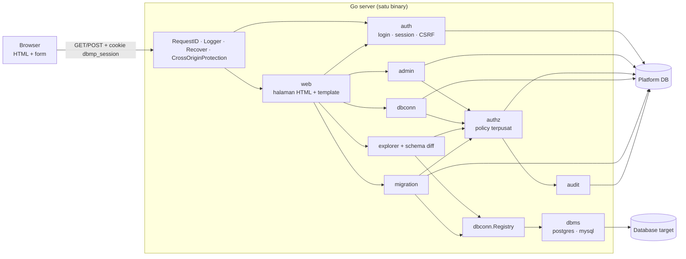

# Arsitektur

Database Management Platform adalah **modular monolith**: satu binary Go yang menyajikan halaman HTML
server-rendered (`html/template`) di `/` dan JSON API di `/api`, dengan satu PostgreSQL sebagai
*platform DB* (user, session, grant, koneksi, riwayat migration, audit). Database yang dikelola user
disebut *database target*. Tidak ada SPA: setiap navigasi memuat halaman penuh dari server dan setiap
aksi adalah form POST yang diakhiri redirect.



## Alur request halaman terlindungi

1. Middleware umum (`httpx.NewRouter`): request ID, logger yang tidak mencatat query/body/cookie,
   recover panic dan `http.CrossOriginProtection`.
2. `web.Server.protect`: memanggil `auth.Service.WebAuthenticate` (cookie, validasi session, rotasi), lalu
   menaruh `authz.Principal` di context. Tanpa session valid, request GET diarahkan (303) ke
   `/login?next=...`. Untuk method non-GET, field form `_csrf` dibandingkan constant-time dengan token
   HMAC milik family session.
3. Handler halaman (`internal/web/*_pages.go`): membaca query dan form, memanggil service domain.
4. Service domain: memanggil `authz.Authorizer.Authorize(principal, aksi, database)` lalu menjalankan
   logika bisnis. Penolakan otomatis tercatat di audit log.
5. Hasil dirender dengan `Render` (template), atau `Redirect` (303 + flash) setelah mutasi. Error dipetakan
   `Fail` menjadi halaman error (403, 404, 409, 422, 503, 500). JSON API di `/api/*` memakai
   `auth.Middleware` dan Problem Details seperti sebelumnya.

## Layering

```
handler (halaman HTML / JSON)  →  service (logika + authz)  →  sqlc queries / dbms driver
```

- Handler tidak berisi SQL; service tidak tahu soal HTTP.
- Domain tidak memanggil query domain lain secara langsung; lewat service atau interface.
- Query platform DB ditulis sebagai SQL biasa di `platformdb/queries/*.sql` (satu file per domain) dan
  di-generate oleh sqlc. Schema platform DB dikelola goose (`platformdb/migrations`, di-embed dan
  dijalankan otomatis saat server start). Ini terpisah dari fitur migration milik user.

## Paket

| Paket | Isi | Pemilik |
|---|---|---|
| `cmd/server` | entrypoint, wiring semua domain | Miguel |
| `cmd/dbmpctl` | CLI `create-admin` | Miguel |
| `internal/config` | env var → struct | Miguel |
| `internal/httpx`, `internal/apperr` | router, middleware umum, Problem Details, pagination | Miguel |
| `internal/auth` | password Argon2id, session, CSRF, handler login/logout/me | Miguel |
| `internal/authz` | daftar aksi, policy, level efektif multi-group | Miguel |
| `internal/admin` | API user, group, anggota, grant | Miguel |
| `internal/audit` | audit log + pencatat penolakan authz | Miguel |
| `internal/web` | lapisan halaman: server, render, flash, CSRF form, template, CSS; halaman login, admin, koneksi, explorer, schema diff | Miguel, Edo |
| `internal/secret` | AES-256-GCM untuk password database target | Edo |
| `internal/dbms` | interface driver + implementasi PostgreSQL dan MySQL | Edo, Rhino |
| `internal/dbconn` | CRUD koneksi, test koneksi, registry pool per database | Edo |
| `internal/schema`, `internal/explorer`, `internal/schemadiff` | introspeksi, viewer, snapshot, diff | Edo |
| `internal/migration` | draft, eksekusi transaksional, riwayat, EXPLAIN | Rhino |
| `internal/web` (halaman migration) | `migration_pages.go` dan `templates/migrations` | Rhino |

## Lapisan web

- `web.Server` menyediakan `Render`, `Redirect` (303 + flash cookie sekali-baca), `Fail` (pemetaan error
  ke halaman), `AddNav` dan `AddDatabaseTab` agar setiap domain mendaftarkan menunya sendiri.
- Template `html/template` di `internal/web/templates` (satu `layout.html`, partial bersama, satu
  direktori per domain). Escaping otomatis; tidak ada `template.HTML` pada data pengguna.
- Semua mutasi memakai `POST` dengan pola Post/Redirect/Get; validasi gagal menampilkan form yang sama
  dengan status 422. Aksi destruktif memakai halaman konfirmasi.
- Header keamanan pada setiap halaman: `Content-Security-Policy: default-src 'self'`, `nosniff`,
  `Cache-Control: no-store`. Tidak ada JavaScript.
- Menyembunyikan tombol di template hanya kenyamanan; service tetap memeriksa hak akses.

### Menambah halaman baru

Contoh (di dalam paket `internal/web`, mengikuti `connections_pages.go`):

```go
func (s *Server) mountReports(r chi.Router) {
	r.Get("/reports", s.reportList)
	r.Post("/reports/new", s.reportCreate)
}

func (s *Server) reportList(w http.ResponseWriter, r *http.Request) {
	p, err := s.authorizeAction(r, authz.ActionManageGroups)
	if err != nil {
		s.Fail(w, r, err)
		return
	}
	items, err := s.reports.List(r.Context(), p)
	if err != nil {
		s.Fail(w, r, err)
		return
	}
	s.Render(w, r, http.StatusOK, "reports/list", reportsView{Items: items})
}
```

Template `templates/reports/list.html` mendefinisikan `title` dan `content`; form selalu menyertakan
`{{template "csrf" .}}`:

```html
{{define "title"}}Laporan{{end}}
{{define "content"}}
<form method="post" action="/reports/new">{{template "csrf" .}}<button class="btn" type="submit">Buat</button></form>
{{end}}
```

Tes memakai fixture `newEnv` (`pages_setup_test.go`) dan `fakeGuard`; tes `route_contract_test.go`
otomatis memeriksa rute baru (wajib login, wajib `_csrf` pada POST, menolak request lintas situs):

```go
func TestReportListRejectsNonAdmin(t *testing.T) {
	e := newEnv(t, false)
	assert.Equal(t, http.StatusForbidden, e.get("/reports", viewerID).Code)
}
```

Daftarkan menu dengan `AddNav(NavItem{Label: "Laporan", Path: "/reports", AdminOnly: true})`, panggil
`mountReports` di dalam `Mount`, dan setiap mutasi harus `POST` yang diakhiri `Redirect` (303).

## Build dan deploy

- **Dev:** `make dev` (container DB) + `make run` (server :8080). Dengan `APP_ENV=dev` template dibaca dari
  disk sehingga perubahan terlihat tanpa menjalankan ulang server.
- **Demo/production:** `make build` membuat `bin/dbmp` dengan template dan aset statis ter-embed
  (`embed.FS`); satu port, satu origin. Set `APP_ENV=production` di belakang HTTPS agar cookie memakai
  `Secure`.

## Testing

- Unit test untuk logika murni (policy, password, splitter SQL, diff, error mapping).
- Integration test memanggil handler/service dengan PostgreSQL/MySQL sungguhan lewat testcontainers;
  waktu session dikendalikan lewat clock yang di-inject sehingga idle, absolute, rotasi, dan grace bisa
  diuji tanpa menunggu.
- Halaman: `httptest` terhadap router penuh (status, redirect, cookie, isi HTML, penolakan akses, CSRF) dengan
  fixture testcontainers; alur login → admin → explorer → logout diuji dengan session asli di `cmd/server`.
